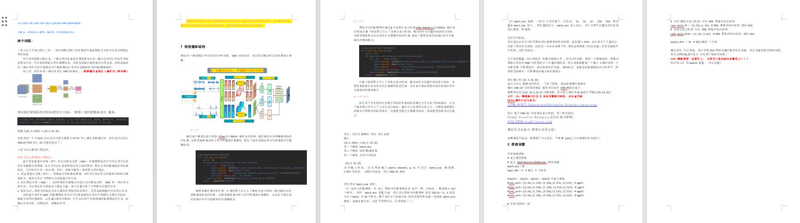
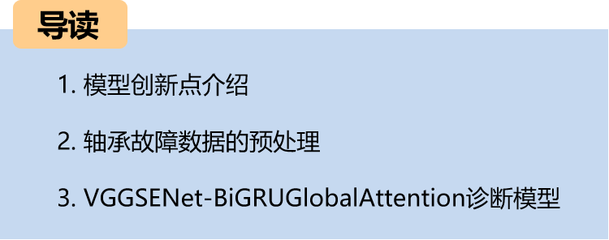
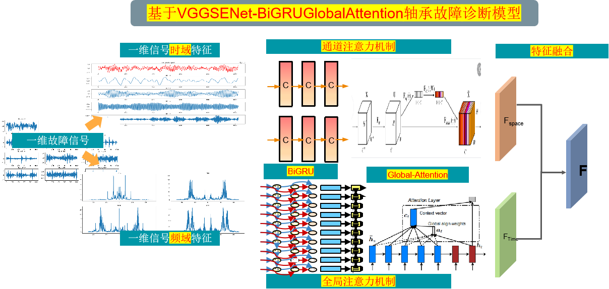
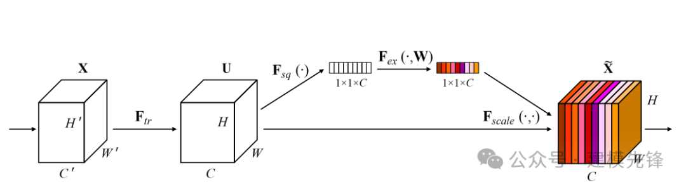
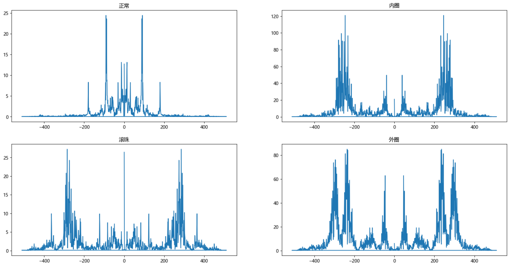
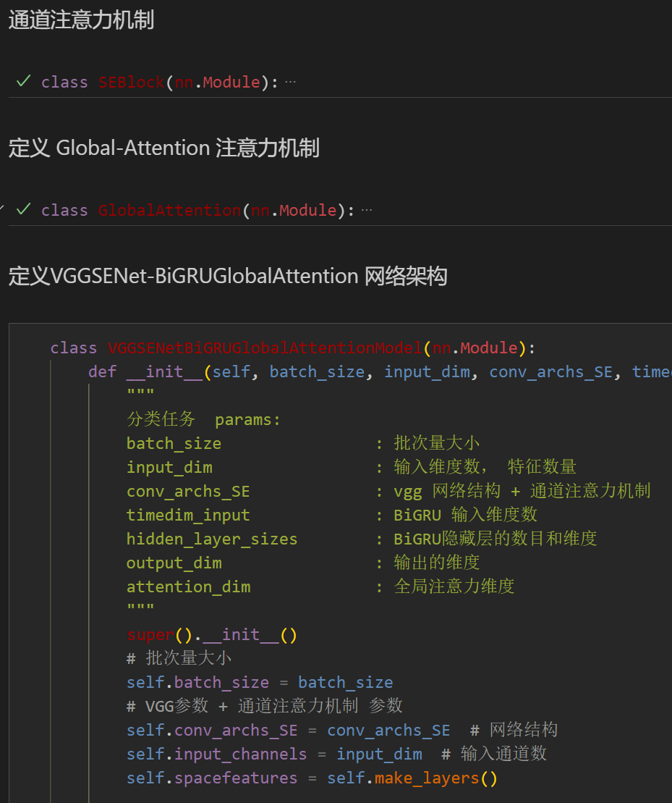
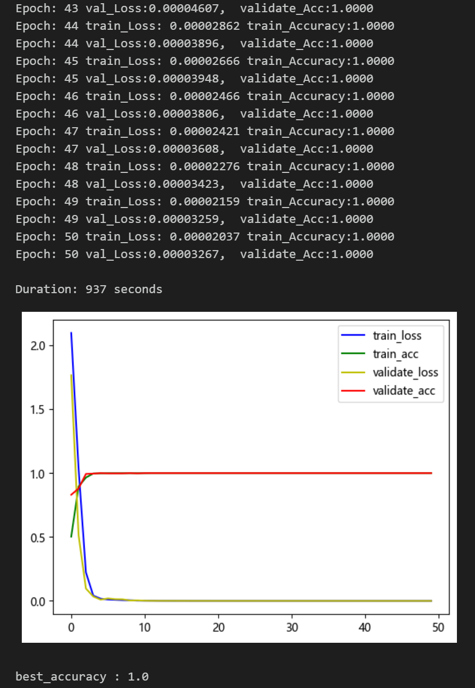
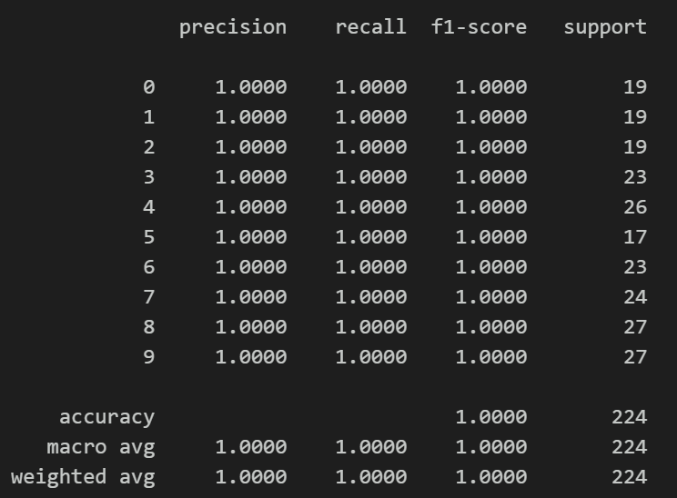
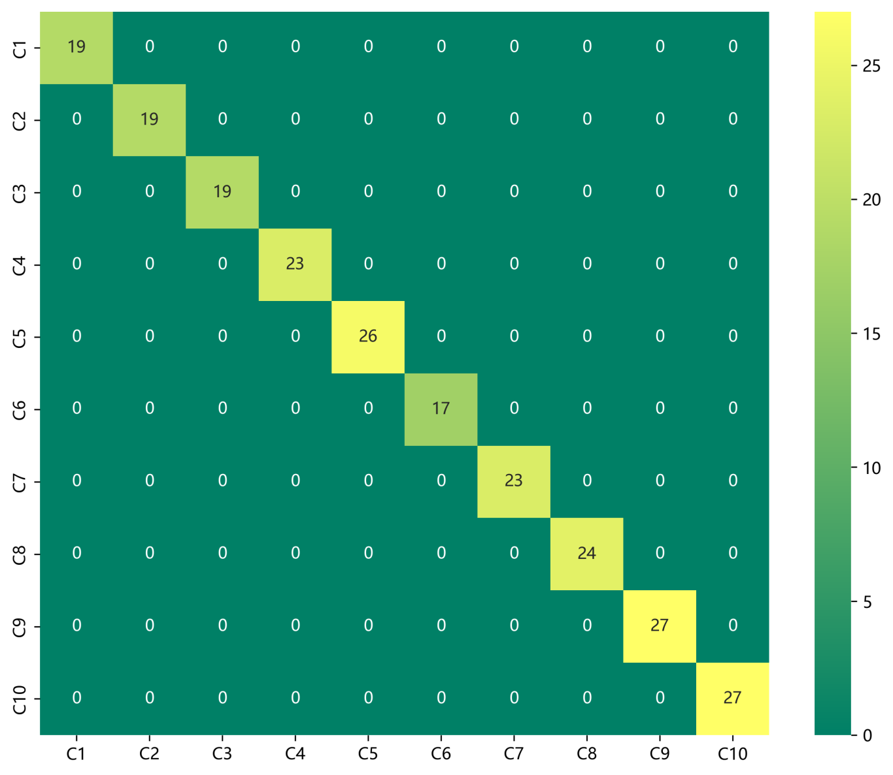
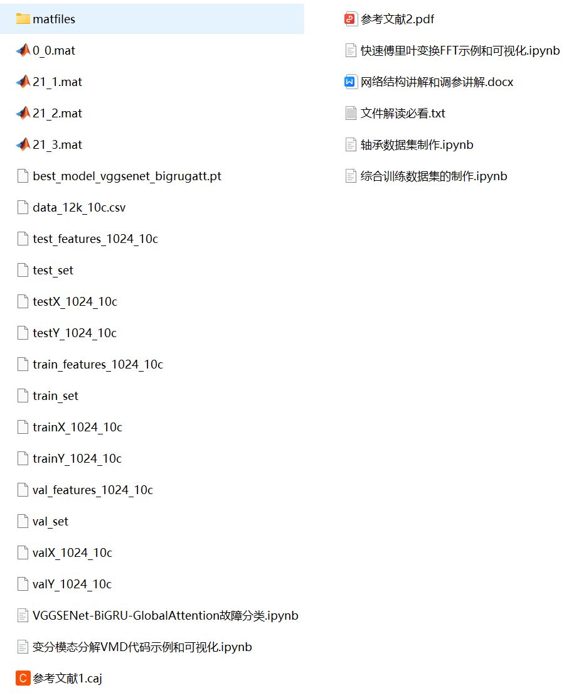

# Attention Magic Mod | Superb Bearing Fault Diagnosis Model!

Preface:

This product is based on the channel attention SENet for improving VGG and a GlobalAttention-optimized BiGRU model for bearing fault diagnosis. 
Environment: Python 3.9, PyTorch 1.8 or above are all acceptable.
Effectiveness: The models achieve 100% fault recognition rate on the Xiuyun University and Harbin Institute of Technology Aerospace Data Sets!
Model innovation points, students who need to complete their graduation projects or write papers can't miss this, with rich modules and high innovation, excellent performance!
Innovation points:
1. We propose a data preprocessing method based on Fast Fourier Transform (FFT) and Variational Mode Decomposition (VMD) to extract fault features in different frequency ranges from bearing vibration signals, capturing the time-frequency characteristics of fault signals and reducing noise interference. This helps improve the detection and diagnosis effects of bearing faults, enhancing the accuracy and sensitivity of fault diagnosis;
2. We design an improved VGG model based on channel attention mechanism (SENet) to extract multi-scale feature space features after preprocessing fault signals;
3. We propose a global attention-optimized BiGRU network model to extract time-domain features after preprocessing fault signals;
4. By merging spatial and temporal features through parallel models, we enhance the representation ability of features to achieve fault signal identification, achieving excellent results! Note: This product also includes accompanying model explanations (for learning network structures) and parameter adjustment explanations! Students who need to complete their graduation projects or write papers should not miss this, with rich modules, high innovation, excellent performance!!
This paper preprocesses the data based on the bearing data from Case Western Reserve University (CWRU) for Fast Fourier Transform (FFT) and Variational Mode Decomposition (VMD). Finally, it implements a spatio-temporal feature fusion model based on VGGSENet-BiGRUGlobalAttention to classify fault data. For more details about the bearing data from CWRU, please refer to the following article:
Python-Case Western Reserve University (CWRU) Bearing Data Interpretation and Classification Process
1. Overall Structure of the Model
\tPreprocessing\t: The one-dimensional fault signals are respectively transformed by FFT, decomposed by VMD, and then the results of the decomposition are stacked.
\t  
\n        \n  
Branch 1: By employing an improved VGG model network based on channel attention mechanism (SENet), the weights of channel features are adaptively adjusted, enabling the model to automatically learn the importance of different channels. This process extracts significant spatial features related to faults from bearing fault signals.
Branch Two: After preprocessing, the data is simultaneously processed through a BiGRU network optimized with GlobalAttention. GlobalAttention is a mechanism used to enhance the model's focus on different parts of the input sequence. In the BiGRU model, the global attention mechanism helps the model better concentrate on the most relevant parts of the input sequence, thereby enhancing the model's performance and generalization capabilities. At each time step, the global attention mechanism calculates a weight vector that represents the model's focus on various parts of the input sequence. These weights are then applied to the feature representations output by the BiGRU. By weighting all the features at each position, the model can more specifically focus on important temporal features, improving its ability to perceive temporal characteristics in bearing fault signals.
Feature Fusion: Subsequently, the spatial features and global time-domain features extracted by two branches are stacked to fuse them, enabling the model to better integrate feature representations at different levels, thereby enhancing model performance and generalization capabilities.
Channel Attention Mechanism
\tSqueeze-and-Excitation Networks  
\t  
Global Attention Mechanism:
\tGlobal Attention Mechanism\t  
2. Data Preprocessing for Bearing Faults
2.1 Import Data
Refer to the previous article for preprocessing of fault classification 10, and the Case Western Reserve University bearing data set: Classification 10 dataset.
\ttrain_set, val_set, test_set are all divided into training set, validation set and test set according to the ratio of 7:2:1, and finally save the data.
2.2 Visualization of Fault FFT Transformation
2.3 Visualization of Failure Decomposition in VMD
\t  
2.4 Feature Preprocessing of Fault Data Dataset
3. Bearing Fault Diagnosis Classification Based on FFT-VMD+VGGSENet-BiGRUGlobalAttention
\t3.1 Define the VGGSENet-BiGRUGlobalAttention classification network model
3.2 Set parameters and train the model
50 epochs, with 100% accuracy using the FFT-VMD+VGGSENet-BiGRUGlobalAttention network. The FFT and VMD can effectively extract multi-scale features from signals. The innovative VGGSENet-BiGRUGlobalAttention model is capable of fully extracting spatial and temporal features of bearing fault signals, with fast convergence speed, superior performance, high accuracy, and the ability to extract important features from the frequency domain and time domain characteristics of the fault signal, resulting in significant effects.
Note: Adjust parameters accordingly:
- Adjust the number of VGG layers and hidden layer dimensions, fine-tune learning rates;
- Adjust the number of BiGRU layers and attention dimensionality, increase more epochs (be cautious to prevent overfitting);
- Change the shape of one-dimensional signal stacking (set appropriate length and dimension);
- Model evaluation:
- Accuracy, Precision, Recall, F1 Score
- Fault classification confusion matrix:
Previously excellent content:
Python-Kansas Wesleyan University (CWRU) Bearing Data Interpretation and Classification Process
Python Bearing Fault Diagnosis (Part I): Short-Time Fourier Transform STFT
Python Bearing Fault Diagnosis (Part II): Continuous Wavelet Transform CWT
Python Bearing Fault Diagnosis (Part III): Empirical Mode Decomposition EMD
Pytorch-LSTM Bearing Fault One-Dimensional Signal Classification (Part I)
Pytorch-CNN Bearing Fault One-Dimensional Signal Classification (Part II)
Pytorch-Transformer Bearing Fault One-Dimensional Signal Classification (Part III)
Python Bearing Fault Diagnosis (Part IV): Fault Classification Based on EMD-CNN
Python Bearing Fault Diagnosis (Part V): Fault Classification Based on EMD-LSTM
Python Bearing Fault Diagnosis (VI) Failure Classification Based on EMD-Transformer
Python Bearing Fault Diagnosis (VII) - Fault Classification Based on EMD-CNN-LSTM
Python Bearing Fault Diagnosis (Part 8) - Fault Classification Based on EMD-CNN-GRU Parallel Model
Bearing Fault Identification Model Based on FFT + CNN - BiGRU-Attention for Time and Frequency Feature Attention Fusion
Bearing Fault Identification Model Based on FFT + CNN - Transformer Time-Domain and Frequency-Domain Feature Fusion
Python Bearing Fault Diagnosis (IX) Fault Classification Based on VMD+CNN-BiLSTM
Python Bearing Fault Diagnosis (10) Fault Classification Based on VMD+CNN-Transformer
Python Bearing Fault Diagnosis (11) Based on VMD+CNN-BiGRU-Attenion for Fault Classification
Cross Attention FFT + CNN - BiLSTM-CrossAttention Bearing Fault Identification Model
Cross Attention Fusion of Time-Domain and Frequency-Domain Features for Bearing Failure Identification Model with FFT + CNN-Transformer-CrossAttention
Python Bearing Fault Diagnosis Beginner Tutorial
Python Bearing Fault Diagnosis (13) Super-strong Machine Learning Recognition Model Based on Fault Signal Feature Extraction
Python Bearing Fault Diagnosis (14) High-Innovation Fault Identification Model
Python Bearing Fault Diagnosis (15) One-Dimensional Fault Signal Recognition Model Based on CNN-Transformer
Python Bearing Fault Diagnosis (16) High-Innovation Fault Identification Model (II)
| SCI 1 Zone High-Innovation Bearing Fault Diagnosis Model!
Conclusion
2. Friends who enjoy the content can follow, give the article a "like", share on social media or discuss in groups.

## Images

<!-- PAYMENT_BLOCK -->

## Get this dataset

- Payment link (Stripe): [Buy now](https://buy.stripe.com/3cs8yP7sY87d0vu9AB)
- Payment QR code: 

<!-- /PAYMENT_BLOCK -->
